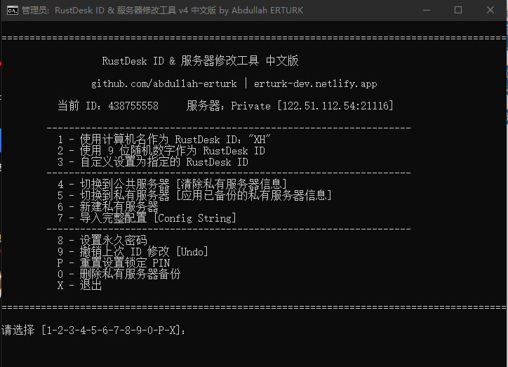

# RustDesk ID & 服务器修改工具（中文本地化版）v4

图形化修改 RustDesk 本地客户端 ID / 中继(Private)服务器 / 访问 Key / 配置字符串 / 永久密码 的批处理脚本，是原作者 Abdullah ERTURK 项目的中文本地化版本。

*   **原始项目**: [abdullah-erturk/RustDesk-ID-Server-Changer](https://github.com/abdullah-erturk/RustDesk-ID-Server-Changer)
*   **RustDesk 官方**: [rustdesk/rustdesk](https://github.com/rustdesk/rustdesk)

---

## ⚠️ 关于许可证与版权（请务必阅读）

原作者仓库中**没有附带 LICENSE 授权文件**。按默认规则，未声明许可的作品属于「保留所有权利」。因此：

*   本仓库**不会**擅自替原作者添加任何开源许可证；
*   本仓库**保留原作者** Abdullah ERTURK 的全部署名与版权，仅对界面文字做中文本地化；
*   **二次分发 / 使用请遵循上游项目的许可约定**。如需明确的开源许可，建议先向上游作者确认；
*   如果你只是自己或团队内部使用，以上不影响正常使用。

---

## 💡 为什么需要这个工具？（解决“ID 改了又变回”的痛点）

很多用户尝试手动用记事本修改 `RustDesk.toml`，重启后发现 ID 又变回了原来的。这是因为：
1.  **服务未停止**：RustDesk 后台服务在运行，重启时会用内存里的旧配置覆盖你的修改。
2.  **路径错误**：如果你改的是 `%AppData%` 下的普通用户配置，而软件是以系统服务运行的，它会优先读取 `C:\Windows\ServiceProfiles\LocalService\...` 下的配置。

本脚本在修改前会**强制停止所有 RustDesk 进程**，自动识别正确的配置文件路径（支持便携版与安装版），并执行修改，完美解决 ID 回退问题。

---

## 🌟 功能一览

| 编号 | 功能说明 |
| :--- | :--- |
| **1** | 用计算机名设置 RustDesk ID（机房 / 批量部署场景，免重启） |
| **2** | 用 9 位随机数字设置 ID（与 RustDesk 原生格式一致，各版本通用） |
| **3** | 自定义 ID（*注意：RustDesk 要求 ID 必须以字母开头，且长度为 6-9 位*） |
| **4** | 切换到 Public 公共服务器（自动安全备份当前私有服务器配置） |
| **5** | 切换到 Private 私有服务器（恢复之前备份的配置） |
| **6** | 新建私有服务器（输入 IP/Host 与 Key） |
| **7** | 导入完整配置字符串（RustDesk 导出的 ID/Relay/API + Key 一次性导入） |
| **8** | 设置永久访问密码（不少于 6 位） |
| **9** | 撤销上一次 ID 修改（用修改前的备份回滚） |
| **P** | 清除设置锁 PIN（*仅限忘记密码的本人设备使用*，无需知道旧 PIN） |
| **0** | 删除私有服务器备份文件 |

**其他特性：**
*   菜单顶部实时显示当前 ID 与活动服务器（Public/Private + 地址）；
*   每步操作后用 `rustdesk.exe --get-id` 自动校验，并写入带时间戳的 `RustDesk_Changer.log` 日志；
*   通过注册表动态检测安装路径，兼容 portable 便携版；
*   修改配置时停掉全部 RustDesk 进程，解决 Windows Server / RDP 多会话「ID 改完又回退」的问题，改完自动重启用户会话 GUI；
*   中文界面 + GBK (chcp 936) 代码页，命令行不乱码。

---

## 🚀 使用方法

1. 下载 `RustDesk_ID_Server_Changer_中文版.bat`；
2. **右键「以管理员身份运行」**（脚本也会自动尝试提权）；
3. 按菜单编号选择操作；
4. 完成后重启 / 让脚本自动重启 RustDesk 即生效。

---

## 📁 文件清单 & 注意事项

*   `RustDesk_ID_Server_Changer_中文版.bat` —— 脚本本体。
    *   ⚠️ **编码警告**：本文件采用 **GBK 编码** 保存。**请勿**用 VS Code 等编辑器将其另存为 UTF-8，否则运行时会中文乱码！推荐直接在网页点击 `Download` 下载。
*   `README.md` —— 本说明（UTF-8）。
*   `脚本界面截图.png` —— 运行界面截图。

---

## 🛡️ 免责声明

本脚本仅修改本机 RustDesk 的连接配置，请用于连接你自有或已获授权的服务器。因使用本工具造成的任何数据、连接或系统问题，风险自负。

## 🤝 致谢

*   原始功能与逻辑：[Abdullah ERTURK](https://github.com/abdullah-erturk)
*   RustDesk：[https://github.com/rustdesk/rustdesk](https://github.com/rustdesk/rustdesk)

---

## 💡 技术原理解析：为什么你手动改 RustDesk.toml 会失败（ID 回退）？

很多用户在网上搜到教程，用记事本打开了 `RustDesk.toml`，把 `enc_id` 改成了 `id`，保存并重启软件，却发现**ID 又变回了原来的**。这通常是因为踩了以下两个坑：

### 坑 1：改错了配置文件路径（系统服务 vs 用户配置）
RustDesk 在 Windows 下有两套配置路径：
*   **普通用户路径**：`%AppData%\RustDesk\config\RustDesk.toml` （很多人改的是这个）
*   **系统服务路径**：`C:\Windows\ServiceProfiles\LocalService\AppData\Roaming\RustDesk\config\RustDesk.toml`

如果你安装 RustDesk 时勾选了“安装为系统服务”，或者软件是以管理员权限运行的，它会**优先读取并写入系统服务路径下的配置**。这时候你改普通用户路径，根本不会生效。

### 坑 2：后台服务没有停止（内存覆盖文件）
RustDesk 分为“前台界面”和“后台服务”两个进程。
当你点击软件右上角“X”关闭窗口时，**后台服务（rustdesk.exe 和 rustdesk --service）并没有真正退出**，它依然在内存里运行。
此时你修改了 `RustDesk.toml`，当你重新打开软件时，后台服务会直接从内存里读出旧的 ID，并**瞬间覆盖掉你刚刚在记事本里修改的内容**。

---

### 🛠️ 本工具是如何完美解决这个问题的？

`RustDesk_ID_Server_Changer_中文版.bat` 脚本在底层执行了以下标准化流程，彻底杜绝了 ID 回退：
1.  **强制清理进程**：执行前强制 `taskkill` 掉所有前台和后台 RustDesk 进程，确保内存中的旧配置被释放。
2.  **动态探测路径**：通过读取注册表，精准定位到当前系统真正生效的配置文件（无论是便携版、普通用户还是系统服务路径）。
3.  **安全替换与校验**：将 `enc_id` 替换为明文的 `id`，保存后自动启动服务，并利用 `rustdesk.exe --get-id` 命令进行二次校验，确保新 ID 真正生效。

----

## 🛠️ 进阶：如何手动正确修改 ID（Windows 环境）

如果你不想使用本工具，想完全手动操作，请务必严格按照以下步骤（**顺序千万不能错**）：

1.  **完全停止服务**：按 `Win + R` 键，输入 `services.msc` 回车打开服务管理器。找到 **RustDesk** 服务，右键点击**“停止”**。（此时不要打开 RustDesk 客户端界面）
2.  **修改正确的配置文件**：用记事本打开路径 `C:\Windows\ServiceProfiles\LocalService\AppData\Roaming\RustDesk\config\RustDesk.toml`。
3.  **替换字段**：找到第一行的 `enc_id = '...'`，将其**整行替换**为明文字段 `id = '你的新ID'`（注意：去掉 `enc_`，且新 ID 必须以字母开头）。
4.  **重启服务验证**：保存文件后，回到服务管理器，右键 RustDesk 服务点击**“启动”**。最后打开 RustDesk 客户端，查看 ID 是否已成功更新。

> 💡 **提示**：手动操作极其容易因为路径找错或未彻底杀灭进程而失败。为了节省时间，推荐直接使用本仓库的自动化脚本 `RustDesk_ID_Server_Changer_中文版.bat`，脚本在底层执行的正是上述标准化流程，彻底杜绝了 ID 回退。

---
